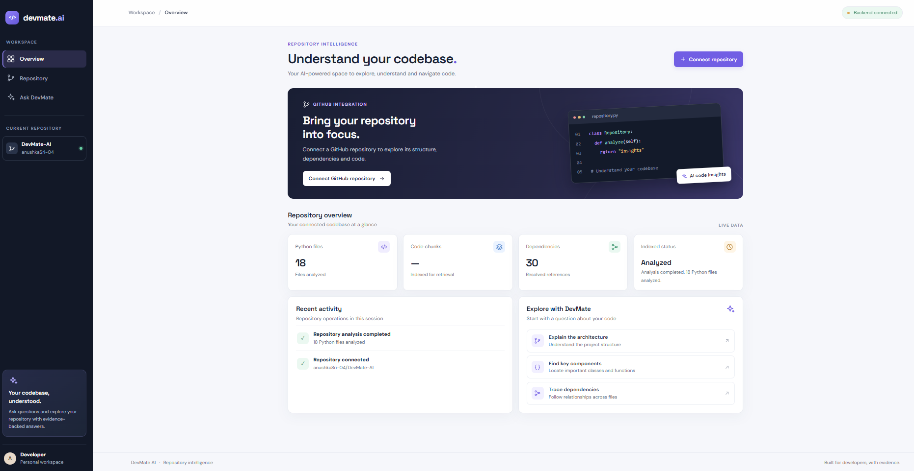
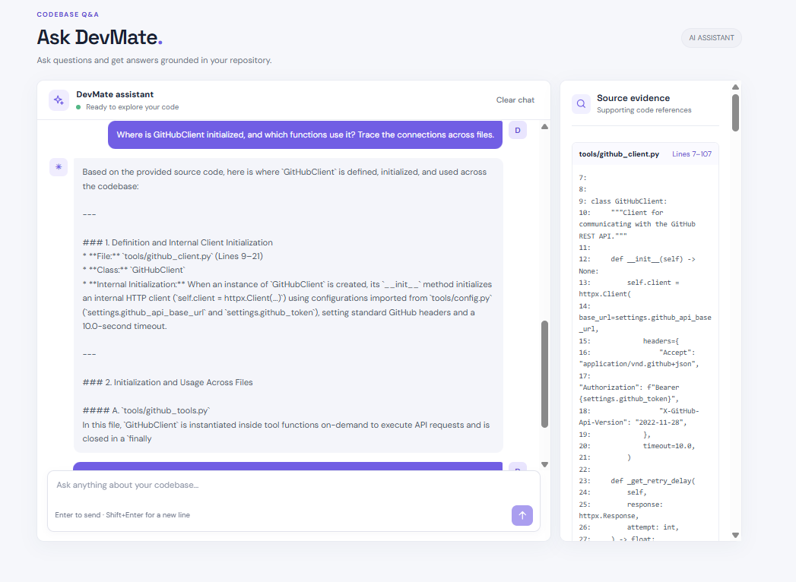
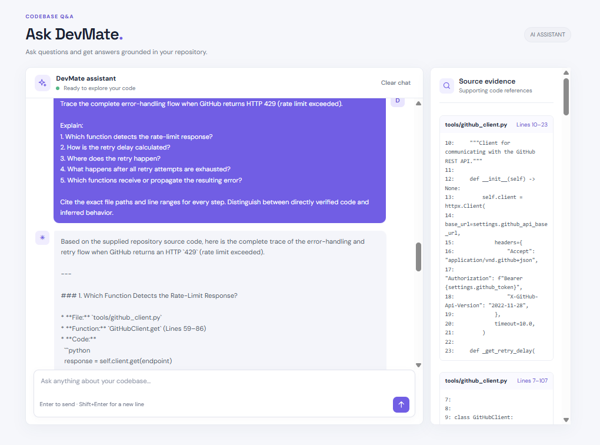

# DevMate AI

**A read-only, repository-aware AI coding assistant that combines static code analysis (Python AST) with Retrieval-Augmented Generation (RAG) to answer natural-language questions about a GitHub repository, grounded in its actual source code. Fully containerised with Docker and validated by a GitHub Actions CI pipeline.**

<!-- 


--- -->

## Table of Contents

1. [Overview](#overview)
2. [Features](#features)
3. [Architecture](#architecture)
4. [How It Works](#how-it-works)
5. [Tech Stack](#tech-stack)
6. [Project Structure](#project-structure)
7. [Quick Start (Docker)](#quick-start-docker)
8. [Local Development (without Docker)](#local-development-without-docker)
9. [Docker and Deployment Details](#docker-and-deployment-details)
10. [CI with GitHub Actions](#ci-with-github-actions)
11. [API Reference](#api-reference)
12. [MCP Tools](#mcp-tools)
13. [Example Questions](#example-questions)
14. [Testing](#testing)
15. [Results and Observations](#results-and-observations)
16. [Known Limitations](#known-limitations)
17. [Scope and Roadmap](#scope-and-roadmap)

---

## Overview

Sending an entire repository to an LLM is slow, expensive and noisy. DevMate AI instead:

1. Pulls a Python repository from GitHub,
2. Analyses it statically with Python's `ast` module (functions, classes, imports, calls, cross-file references, entry points),
3. Splits the code into searchable chunks and indexes them in ChromaDB,
4. Retrieves the most relevant code with **hybrid lexical + semantic search** fused using **Reciprocal Rank Fusion (RRF)**,
5. Sends only that context to **Gemini**, and returns the answer **together with the supporting source-code evidence**.

DevMate is **read-only**: it explains code and never modifies the connected repository.

## Features

- **GitHub integration**: authenticated REST client with pagination, rate-limit handling and retry with exponential backoff (`Retry-After` / `X-RateLimit-Reset` aware).
- **Repository intelligence**: file tree, languages, important files, dependency extraction (`requirements.txt`, `pyproject.toml`) and technology categorisation.
- **AST-based code understanding**: functions, classes, methods, imports, calls, docstrings, `__main__` guards and syntax-error detection.
- **Cross-file analysis**: symbol index, import-binding resolution (including aliases), module-qualified call resolution, and classification of unresolved calls.
- **Module graph and entry-point detection**: internal dependency graph; `primary_application` vs `standalone_utility` entry points.
- **Hybrid retrieval**: lexical search for exact identifiers plus Sentence-Transformers/ChromaDB semantic search, merged with RRF.
- **Grounded Q&A with evidence**: answers cite file paths and snippets; insufficient-context cases are reported instead of invented.
- **Conversation memory**: follow-ups such as "Where is *it* initialised?" resolve against prior turns.
- **FastAPI backend and web dashboard** (Overview, Repository, Ask DevMate).
- **MCP server** exposing GitHub and repository-analysis tools to MCP-compatible clients.
- **Dockerised deployment**: FastAPI backend and Nginx frontend orchestrated with Docker Compose, with persistent ChromaDB storage.
- **Continuous Integration**: GitHub Actions runs the test suite and builds both Docker images on every push and pull request.

## Screenshots

### Dashboard

<p align="center">
  
</p>

### Ask DevMate: grounded Q&A with source evidence

<p align="center">
  
</p>
<p align="center"><em>Cross-file tracing: where <code>GitHubClient</code> is initialised and which functions use it.</em></p>

<p align="center">
  
</p>
<p align="center"><em>Error handling: the full HTTP 429 retry and backoff flow.</em></p>

## Architecture

### Application pipeline

```
                    USER
                      |
               Natural-language query
                      |
              Repository Q&A Engine
                      |
              Question processing
                      |
                Hybrid Retriever
                /            \
        Lexical search    Semantic search
        (identifiers)     (embeddings + ChromaDB)
                \            /
             Result fusion (RRF)
                      |
              Context retrieval
                      |
        AST / cross-file repository data
                      |
               Evidence builder
                      |
             Prompt construction
                      |
                    Gemini
                      |
           Answer + evidence + file refs
                      |
                Frontend dashboard
```

### Container architecture

```
            USER / BROWSER
                  |
           localhost:5500
                  |
                  v
      +-----------------------+
      |  devmate-frontend     |
      |  Nginx :80            |
      |  HTML / CSS / JS      |
      +-----------------------+
                  |
        /api reverse proxy
                  |
                  v
      +-----------------------+
      |  devmate-api          |
      |  FastAPI + Uvicorn    |   <-- localhost:8000
      |  :8000                |
      +-----------------------+
                  |
                  v
      ./data/chroma  (bind mount)
      Persistent ChromaDB storage
```

## How It Works

| Stage | What happens |
|-------|--------------|
| 1. Connect | User supplies `owner` and `repo`; DevMate fetches repository metadata and the recursive Git tree once and reuses the snapshot. |
| 2. Retrieve source | Python files are downloaded and Base64-decoded (limits: 50 files, 100 KB per file). |
| 3. Analyse | AST analysis, module graph, entry-point detection and cross-file reference resolution produce a unified repository analysis (cached). |
| 4. Chunk | Code is split into logical chunks (class/initialisation, methods, functions) with repo, path and line metadata. |
| 5. Embed and index | Sentence Transformers embeds each chunk; chunks and metadata are stored in ChromaDB. |
| 6. Retrieve | A question is run through lexical and semantic search; results are merged via RRF. |
| 7. Build evidence | Top chunks are enriched with AST/cross-file data and turned into file/line evidence. |
| 8. Generate | A grounded prompt (question, context, evidence, conversation history) is sent to Gemini. |
| 9. Respond | The answer and its supporting source snippets are returned to the dashboard or MCP client. |

**Reciprocal Rank Fusion:** `RRF(d) = sum over rankings r of 1 / (k + rank_r(d))`. Chunks that rank well in both lexical and semantic results rise to the top.

## Tech Stack

| Category | Technology |
|----------|-----------|
| Language | Python 3.11 |
| Backend | FastAPI, Uvicorn |
| Code analysis | Python `ast` |
| GitHub access | GitHub REST API, HTTPX |
| Configuration | Pydantic Settings, `.env` |
| Embeddings | Sentence Transformers |
| Vector store | ChromaDB |
| Retrieval | Lexical + semantic, Reciprocal Rank Fusion |
| LLM | Google Gemini (`google-genai`) |
| Protocol | Model Context Protocol (MCP SDK) |
| Frontend | HTML, CSS, JavaScript |
| Containers | Docker, Docker Compose, Nginx |
| CI | GitHub Actions, Docker Buildx |
| Quality | Pytest, pytest-asyncio, Respx, Ruff, MCP Inspector |

## Project Structure

```
MCP-DevMateAI/
├── .github/
│   └── workflows/
│       └── ci.yml                       # test + Docker build pipeline
├── src/
│   └── devmate/
│       ├── __init__.py
│       ├── api.py                       # FastAPI app
│       ├── config.py                    # Pydantic settings
│       ├── issue_tools.py
│       ├── clients/
│       │   └── github_client.py         # HTTP, auth, retries, rate limits
│       ├── tools/
│       │   ├── github_tools.py          # repos, details, issues
│       │   └── repository_tools.py      # structure, dependencies
│       ├── services/
│       │   ├── project_profile.py       # combined repository profile
│       │   ├── source_code.py           # Python source retrieval
│       │   ├── code_analyzer.py         # AST analysis
│       │   ├── module_graph.py          # internal dependency graph
│       │   ├── entry_point_analysis.py
│       │   ├── cross_file_analysis.py   # symbol index, reference resolution
│       │   └── repository_code_analysis.py
│       └── mcp/
│           └── server.py                # MCP tool registration
├── devmate-frontend/
│   ├── Dockerfile                       # Nginx image
│   ├── nginx.conf                       # static hosting + /api reverse proxy
│   ├── index.html
│   ├── styles.css
│   └── app.js
├── data/
│   └── chroma/                          # persistent ChromaDB data (git-ignored)
├── tests/
├── scripts/
├── archive/
├── Dockerfile                           # backend image
├── docker-compose.yml
├── .dockerignore
├── .env.example
├── pyproject.toml
├── requirements.txt
└── README.md
```

> Module locations for the Q&A/RAG components may differ slightly from the tree above; adjust to match the repository.

## Quick Start (Docker)

### Prerequisites

- Docker and Docker Compose
- A GitHub personal access token
- A Google Gemini API key

### 1. Clone and configure

```bash
git clone https://github.com/anushkaSri-04/DevMate-AI.git
cd DevMate-AI
cp .env.example .env
```

Edit `.env`:

```env
GITHUB_TOKEN=your_github_personal_access_token
GEMINI_API_KEY=your_gemini_api_key
```

Variable names should match `.env.example`. Never commit `.env`.

### 2. Build and start

```bash
docker compose up -d --build
```

### 3. Open the app

| Component | URL |
|-----------|-----|
| Dashboard | http://localhost:5500 |
| Backend health | http://localhost:8000/api/health |
| API docs (Swagger) | http://localhost:8000/docs |

**Typical workflow:** Connect repository, Analyze, Index, then ask questions in *Ask DevMate*.

### Useful commands

```bash
docker compose config --quiet            # validate the Compose file
docker compose ps                        # running containers
docker compose logs --tail=50 devmate-api
docker compose logs --tail=50 devmate-frontend
docker compose down                      # stop and remove containers (data/chroma is kept)
```

## Local Development (without Docker)

```bash
python -m venv .venv

# Windows (CMD)
.venv\Scripts\activate.bat
# Windows (PowerShell)
.venv\Scripts\Activate.ps1
# macOS / Linux
source .venv/bin/activate

pip install -e ".[dev]"
```

Run the backend and frontend in **separate terminals**.

```bash
# Backend: http://127.0.0.1:8000
uvicorn devmate.api:app --reload --app-dir src --host 127.0.0.1 --port 8000
```

```bash
# Frontend: http://127.0.0.1:5500
cd devmate-frontend
python -m http.server 5500
```

> The frontend calls the API at `/api`. In Docker, Nginx proxies this to the backend. For the plain `http.server` setup, you will need to point `API_BASE` in `app.js` at `http://127.0.0.1:8000/api` (the pre-Docker value) or run a proxy.

**MCP server:**

```bash
python -m devmate.mcp.server
```

Inspect it manually with MCP Inspector.

> Windows tip: if packages seem missing even with `(.venv)` showing, run `python -c "import sys; print(sys.executable)"` to confirm the interpreter, or call `.venv\Scripts\python.exe -m pip ...` directly.

## Docker and Deployment Details

### Backend image (`Dockerfile`)

- Base: `python:3.11-slim`; installs the project with `pip install --no-cache-dir .`
- Starts with `uvicorn devmate.api:app --app-dir src --host 0.0.0.0 --port 8000`
- Creates `/app/data/chroma` for vector storage

### Frontend image (`devmate-frontend/Dockerfile`)

- Base: `nginx:alpine`, serving static HTML/CSS/JS (no Node.js build step needed)
- `nginx.conf` forwards `/api/` to `http://devmate-api:8000`, resolved by Docker's internal DNS
- `app.js` uses `API_BASE = "/api"`, so the browser talks to a single origin and no CORS or internal hostnames leak to the client

### Docker Compose (`docker-compose.yml`)

| Service | Container port | Host port | Notes |
|---------|---------------:|----------:|-------|
| `devmate-api` | 8000 | 8000 | Loads `.env`, mounts ChromaDB data, `restart: unless-stopped` |
| `devmate-frontend` | 80 | 5500 | `depends_on` the API, `restart: unless-stopped` |

### Persistent ChromaDB storage

```yaml
volumes:
  - ./data/chroma:/app/data/chroma
```

Indexed data survives container recreation, so repositories do not need re-indexing after a restart. Only one application instance should use this directory at a time.

### Secrets and build hygiene

- Credentials come from `.env` at runtime via `env_file`; they are never baked into an image.
- `.dockerignore` excludes `.env*`, virtual environments, caches, local `data/`, `.git/` and `archive/` from the build context.
- `depends_on` controls startup order only, not readiness (a health check is a planned improvement).

## CI with GitHub Actions

Workflow: `.github/workflows/ci.yml`, triggered on every push, every pull request, and manually (`workflow_dispatch`).

```
Push / Pull Request
        |
        v
  Job 1: test
  - checkout
  - set up Python 3.11 (pip cache)
  - pip install -e ".[dev]"
  - python -m pytest -v
        |
   tests pass?
     |      \
    no       yes
     |        |
   stop       v
        Job 2: docker (needs: test)
        - set up Docker Buildx
        - build backend image   (devmate-api:ci)
        - build frontend image  (devmate-frontend:ci)
```

- The Docker job runs only if the tests succeed.
- Images are built for validation only (`push: false`); nothing is published to a registry.
- The test job uses a dummy `GITHUB_TOKEN` and an empty `GEMINI_API_KEY`, so the suite must (and does by design) use mocked external APIs. No real credentials are exposed in CI.

## API Reference

| Endpoint | Method | Purpose |
|----------|--------|---------|
| `/api/health` | GET | Backend availability check |
| `/api/repository/connect` | POST | Connect a GitHub repository |
| `/api/repository/analyze` | POST | Run AST and cross-file analysis |
| `/api/repository/index` | POST | Chunk, embed and store code in ChromaDB |
| `/api/repository/ask` | POST | Ask a question about the repository |

Example request:

```json
{
  "owner": "anushkaSri-04",
  "repo": "DevMate-AI",
  "question": "Explain the GitHub authentication flow.",
  "session_id": "example-session"
}
```

## MCP Tools

| Tool | Description |
|------|-------------|
| `list_repositories` | Lists the authenticated user's repositories |
| `get_repository_details` | Retrieves repository metadata |
| `list_issues` | Lists issues (open/closed/all, paginated, excludes PRs) |
| `count_open_issues` | Counts open issues |
| `analyze_repository` | Analyses repository structure |
| `analyze_dependencies` | Extracts dependencies and technology categories |
| `get_project_profile_tool` | Returns a combined repository profile |

All tools are read-only.

## Example Questions

- Explain the overall architecture of this repository.
- Where is `GitHubClient` initialised, and which functions use it?
- How does the application obtain the GitHub token and pass it into API requests?
- Trace the complete error-handling flow when GitHub returns HTTP 429.

## Testing

```bash
pytest
ruff check .
```

Coverage includes issue-count logic, GitHub client behaviour (mocked with Respx), retry handling and exhaustion, pagination and state validation, MCP tool registration, tool execution and error propagation (monkeypatched), and an **in-memory MCP client/server integration test** using `ClientSession` that exercises the real protocol. The same pytest suite runs automatically in CI.

## Results and Observations

Measured on this repository (`anushkaSri-04/DevMate-AI`):

| Metric | Result |
|--------|--------|
| Python files found / analysed | 18 / 18 |
| Code chunks extracted / stored | 32 / 32 |
| Failed files | 0 |
| Retrieval time | about 0.04 to 0.20 s |
| End-to-end Q&A time | about 42 to 44 s (dominated by Gemini generation) |

Container verification: both images built, both containers started, and `/api/health` returned `{"status": "ok", "service": "DevMate AI API", "version": "1.0.0"}`.

## Known Limitations

- **Latency:** Q&A takes roughly 42 to 44 s, mostly LLM generation and first-request model loading.
- **Retrieval accuracy:** some queries return irrelevant chunks (for example test files for architecture questions); lexical search can return nothing for conceptual queries.
- **Evidence panel:** the file cited in an answer may not always match the one highlighted in the evidence panel.
- **Dashboard:** the "Code chunks" counter on the Repository page may not refresh after indexing.
- **MCP:** the MCP server and GitHub tools are verified; end-to-end MCP validation of the full Q&A pipeline is tracked separately.
- **Language support:** Python repositories only; analysis is static.
- **Deployment:** no readiness health check or registry publishing yet; the ChromaDB bind mount supports a single running instance.

## Scope and Roadmap

**V1 (current):** single-repository, read-only understanding, Q&A and evidence, containerised with CI.

**Out of scope for V1:** automatic code modification or bug fixing, PR/commit/branch/issue creation, bug investigation and test suggestions, cross-repository intelligence, multi-agent architecture.

**Planned improvements:**
- Publish versioned images to GitHub Container Registry (GHCR)
- Docker layer caching in CI to cut build time
- Backend health check in Docker Compose
- Dependency and image vulnerability scanning
- Automated cloud deployment and environment-specific configs
- Frontend-to-backend integration tests
- Evidence/citation synchronisation, retrieval reranking, response streaming

## License

MIT

## Author

**Anushka Srivastava**: [GitHub](https://github.com/anushkaSri-04)